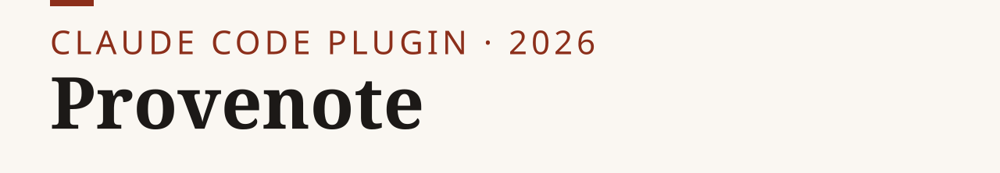
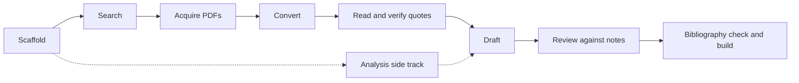

<p><picture><source media="(prefers-color-scheme: dark)" srcset="assets/banner-dark.svg"></picture></p>

# Provenote

[](https://github.com/nik110403/provenote/actions/workflows/ci.yml) [](LICENSE) [](CHANGELOG.md)

**Turn a reading list into source-grounded notes, check a draft against them, and build a paper.**

- Reading list to notes, with every quote checked against its page in the source.
- A draft checked against those notes: uncited and unverified claims are flagged.
- A paper built as PDF, HTML or DOCX, after a bibliography check.

No API key, no server: it runs inside the assistant you already use (Claude Code, or
Codex through an adapter). Early-stage, version 0.2.1.

<sub>Formerly research-kit. Upgrading? Remove the old plugin first; see [INSTALL.md](INSTALL.md#upgrading-from-research-kit).</sub>

[Catalog](CATALOG.md) · [Install guide](INSTALL.md) · [Workflow](docs/workflow.md) · [Lecture quickstart](docs/lecture.md) · [What is verified](docs/verification.md) · [Changelog](CHANGELOG.md)

## Install

In Claude Code (Git must be installed to download the plugin this way; the
[ZIP route](INSTALL.md#codex-adapter) needs none):

```text
/plugin marketplace add nik110403/provenote
/plugin install provenote@provenote
```

Reading or loading a skill does not execute any tool by itself; tools run only when the
assistant calls them.

Check your setup: run `doctor` ([how](docs/doctor.md)). Missing `pdftotext` or `pandoc`?
Run `scripts/install-deps.sh` (macOS/Linux) or `scripts/install-deps.ps1` (Windows);
details in [INSTALL.md](INSTALL.md#install-the-external-tools-one-command). Then ask Claude to start a research project,
search the literature, or verify notes.

<picture><source media="(prefers-color-scheme: dark)" srcset="assets/demo-dark.svg"></picture>

**Other routes:** [Codex adapter](INSTALL.md#codex-adapter), including a ZIP and
file-manager route that needs no Git, Python or terminal ·
[create your own skill](docs/create-your-own.md) ·
[check quotes in a saved Word lecture](docs/word.md) without Zotero or notes.

<details>
<summary>What's inside: 8 skills, 6 roles, 11 tools</summary>

| Kind | Name | What it does |
|---|---|---|
| Skill | [new-research-project](plugins/provenote/skills/new-research-project/SKILL.md) | Scaffold a numbered project tree from a question |
| Skill | [literature-search](plugins/provenote/skills/literature-search/SKILL.md) | Search providers, save a reading list with a receipt |
| Skill | [pdf-to-markdown](plugins/provenote/skills/pdf-to-markdown/SKILL.md) | Convert PDFs to page-marked Markdown |
| Skill | [literature-notes](plugins/provenote/skills/literature-notes/SKILL.md) | Write a structured note with page-pinned quotes |
| Skill | [review-against-notes](plugins/provenote/skills/review-against-notes/SKILL.md) | Review a draft against the notes |
| Skill | [paper-build](plugins/provenote/skills/paper-build/SKILL.md) | Check the bibliography and build PDF or HTML |
| Skill | [analysis-pipeline](plugins/provenote/skills/analysis-pipeline/SKILL.md) | Set up and run a repeatable analysis |
| Skill | [tribunal](plugins/provenote/skills/tribunal/SKILL.md) | Second opinion on a costly decision: sealed multi-lens review with a verbatim record |
| Agent | [source-reader](plugins/provenote/agents/source-reader.md) | Read one source into a note |
| Agent | [claim-checker](plugins/provenote/agents/claim-checker.md) | Judge whether notes support cited claims |
| Agent | [skeptic](plugins/provenote/agents/skeptic.md) | Challenge the strongest claims of a draft |
| Agent | [tribune](plugins/provenote/agents/tribune.md) | One seat of a tribunal: review through a single lens |
| Agent | [refuter](plugins/provenote/agents/refuter.md) | Try to disprove one finding |
| Agent | [pipeline-runner](plugins/provenote/agents/pipeline-runner.md) | Run a trusted analysis pipeline and report |
| Tool | [verify-quotes](plugins/provenote/bin/verify-quotes) | Match each quote, on its stated page, against a markdown copy of the source (hash enforced with `--strict`) |
| Tool | [check-docx](plugins/provenote/bin/check-docx) | Inventory and page-verify typed Word quotations without Zotero; see [Word workflow](docs/word.md) |
| Tool | [lit-search](plugins/provenote/bin/lit-search) | Literature search with provider receipts |
| Tool | [pdf2md](plugins/provenote/bin/pdf2md) | PDF to Markdown with page markers |
| Tool | [check-claims](plugins/provenote/bin/check-claims) | Check each cited note (runs `verify-quotes` on it) and flag uncited or unverified claims; does not judge meaning |
| Tool | [check-bib](plugins/provenote/bin/check-bib) | Check bibliography structure and citation coverage |
| Tool | [build-paper](plugins/provenote/bin/build-paper) | Build PDF, HTML or DOCX with pandoc; [Word export](docs/word-export.md) is one-way output |
| Tool | [new-project](plugins/provenote/bin/new-project) | Scaffold a research project |
| Tool | [new-pipeline](plugins/provenote/bin/new-pipeline) | Scaffold an R or Python pipeline |
| Tool | [tribunal-scribe](plugins/provenote/bin/tribunal-scribe) | Hash-chained verbatim record for a tribunal workspace |
| Tool | [doctor](plugins/provenote/bin/doctor) | Read-only setup diagnostics with per-OS fixes; see [doctor](docs/doctor.md) |

The [complete catalog](CATALOG.md) lists inputs, outputs and dependencies; the
[adapter guide](docs/adapters.md) covers manual use with other assistants.

</details>

## 30-second example

The demo above is a real Claude Code run on a small demo project ([how it was made](tools/demo/README.md)).
The offline quote check on the bundled example below needs no PDF software and no API key.
To reproduce it, clone the repository and, with Python 3.9+,
run from its root:

```sh
cd examples/basic
python3 ../../plugins/provenote/bin/verify-quotes --strict 01_notes/lit/*.md
python3 ../../plugins/provenote/bin/verify-quotes --strict 01_notes/negative/*.md
```

The first prints **14 of 14 PASS**; the second reports the planted fabrication as
**FAIL** (expected). See the [walkthrough](examples/basic/RUN.md). This checks converted
text against quotes, not the original PDF and not whether a claim follows from a quote;
see [what is verified](docs/verification.md) for the evidence limits.

## How it works

Enter at any stage for which you have the inputs. The tools do the mechanical checks;
the assistant roles return text for the main session to save. See
[docs/workflow.md](docs/workflow.md).



## Configuration

Python 3.9+ (standard library only) runs the helpers; PDF conversion needs `pdftotext`,
paper builds need pandoc, and an optional `mailto` setting gives search a contact address. Dependencies,
Windows invocation and limits: [INSTALL.md](INSTALL.md#platform-and-dependency-checklist).

## Contributing

[CONTRIBUTING.md](CONTRIBUTING.md) covers checks, privacy and licensing.

## Security

Report vulnerabilities privately; see [SECURITY.md](SECURITY.md).

## License

Code, skills, agents and templates are [MIT](LICENSE). Documentation under
`docs/` is [CC BY 4.0](LICENSE-docs); bundled papers and conversions retain their
authors' attribution. See the [licensing map](LICENSING.md).
